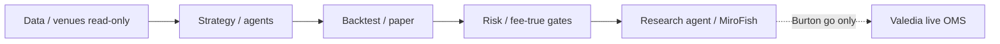

# SUBSUME-STACK-MASTER

**Date:** 2026-09-19  
**Mode:** docs-only research audit (Grok CLI 403 on prior trading-worded prompt; completed by Valedia parent)  
**Fence:** No live flips, no wallet/ACH, no venue writer restore, no Eliza spend, no `VALEDIA_TRADING_HALT` bypass. Valedia runtime sole live risk.

## Pipeline map

| Stage | Best sources from this stack |
|-------|------------------------------|
| data | ccxt (crypto read), nautilus adapters |
| strategy | ai-hedge-fund agents, jesse/freqtrade strategy APIs, hummingbot controllers |
| backtest | jesse, freqtrade, FinRL envs, nautilus |
| risk | hummingbot executors/triple-barrier, fee map (Valedia), FinRL cost-aware rewards |
| research-agent | ai-hedge-fund, eliza plugins (no wallet), Finance Scout |
| execution | **Valedia only** — learn structure from nautilus/hummingbot; do not import live |

## Ranked next research slices (top 10)

1. **Mandate/desk schema** from ai-hedge-fund → unify persona fights + Finance Scout briefs (paper JSON).
2. **Fee-true backtest report template** inspired by jesse (MIT) for Kalshi historical sims.
3. **Triple-barrier / executor sketch** from hummingbot → paper Kalshi clips (no live).
4. **Series whitelist/blacklist** patterns from freqtrade pairlists → join `KALSHI_FEE_MAP` (still gate default off until GET refresh).
5. **FinRL cost-aware reward** → neural/MiroFish enrichment experiments (fenced).
6. **CCXT read-only market data adapter** design doc (no writers).
7. **Nautilus shadow parity deepen** (H6 follow-on) vs Kalshi V2 fills.
8. **Jev as voter** in ai-hedge-fund-style cycle (shadow) — ties MIROFISH-JEV-SHADOW.
9. **Eliza approval-boundary UX** notes for Burton live-flip confirmations (no wallet).
10. **GPL vs MIT reuse policy** note: reimplement freqtrade ideas; prefer jesse helpers if code copy needed.

## License red flags

| Repo | License | Note |
|------|---------|------|
| freqtrade | GPL-3.0 | Ideas only / reimplement |
| nautilus_trader | LGPL-3.0 | Keep sidecar boundary |
| hummingbot | Apache-2.0 | OK with attribution |
| others | MIT | OK |

## Conflicts with existing charters

- **Kalshi-first live** vs crypto bots (freqtrade/jesse/hummingbot/ccxt) — crypto stays paper/shadow.
- **neural-trader fenced** — FinRL must not become OMS.
- **Eliza wallets** — forbidden.
- **KALSHI_FEE_MAP_GATE** still False (AUTONOMY-1 GET done, sports_unknown=0; Burton flip via checklist only).
- Prior H1 dossiers (ai-fund, OpenTerminal, …) remain; this stack is additive.

## Status

Docs written under `recommendations/ADAPT-DOSSIERS/` + this master. FOMO radar (2026-09-21): `ADAPT-DOSSIERS/fomo-robinhood-radar.md` — enrich tags only, `0.55.0`. **Next = Burton** to pick slice 1–3 for Grok Build (docs→small fenced code).
